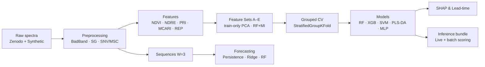

# 🌿 TerraSpectra

**Hyperspectral Crop Stress Detection & Temporal Forecasting**

An end-to-end, reproducible machine learning pipeline and interactive spectral workbench for crop leaf stress detection, biophysical vegetation-index extraction, plant-grouped validation, SHAP interpretability, and chronological multi-horizon canopy forecasting, all under strict zero-leakage guarantees.


-orange)

---

## Table of Contents

1. [Overview](#overview)
2. [Key Results](#key-results)
3. [Features](#features)
4. [Data Sources & Licences](#data-sources--licences)
5. [Methodology](#methodology)
6. [Tech Stack](#tech-stack)
7. [Installation & Setup](#installation--setup)
8. [Running the Pipeline](#running-the-pipeline)
9. [Web Application](#web-application)
10. [Repository Structure](#repository-structure)
11. [Documentation](#documentation)
12. [Limitations](#limitations)
13. [Risks & Mitigations](#risks--mitigations)
14. [Roadmap](#roadmap)
15. [Citation & Acknowledgements](#citation--acknowledgements)
16. [License](#license)

---

## Overview

TerraSpectra addresses three connected crop phenotyping and spectral modeling tasks:

| # | Task | Core modules |
|---|------|--------------|
| 1 | **Detection & Diagnosis**: classify leaf stress from reflectance spectra | `src/preprocessing.py`, `src/features.py`, `src/evaluation.py` |
| 2 | **Interpretability & Early Detection**: rank informative wavelengths/indices and measure detection lead time | `src/inference.py` |
| 3 | **Temporal Trajectory Forecasting**: predict future canopy NDVI per plant | `src/sequences.py` |

### 1. Detection & Diagnosis
- **Preprocessing:** `BadBandDropper` (removes UV-noise band at 365 nm), `ReflectanceSanitizer`, Savitzky–Golay denoising, SNV / MSC scatter normalization, first derivative.
- **Feature extraction:** uncentered domain vegetation indices: **NDVI, NDRE, PRI, MCARI, Red-Edge Position (REP)**.
- **Benchmarking:** Random Forest, XGBoost, SVM (RBF), PLS-DA, and a Neural MLP, evaluated inside a frozen 5-fold `StratifiedGroupKFold(plant_id)`.

### 2. Interpretability & Early Detection
- Ranks spectral wavelengths and indices using validation-fold `TreeExplainer` SHAP values.
- Measures early-detection **lead time** on unseen holdout plants.
- Powers real-time single-spectrum classification and batch CSV scoring.

### 3. Temporal Trajectory Forecasting
- Aggregates longitudinal scans per plant into sliding windows (`W = 3` prior dates).
- Forecasts future canopy NDVI<sub>t+k</sub> for horizons `k ∈ {1, 2, 3}`.
- Compares **Lag-Feature Ridge** and **Lag-Feature Random Forest** against a **Persistence** baseline (ŷ<sub>t+k</sub> = y<sub>t</sub>), strictly inside `GroupKFold(plant_id)`.

---

## Key Results

### 🔒 Leakage Demonstration
Naive row-level splits leak replicate scans of the same plant across folds. Under `StratifiedGroupKFold` vs. a naive random split, **XGBoost (Feature Set E) Macro-F1** changes as follows:

| Split strategy | Macro-F1 |
| --- | --- |
| Grouped (`StratifiedGroupKFold`, honest) | **0.4877** |
| Naive random split (leaky) | 0.5758 |
| **Inflation from leakage** | **+0.0881** |

> Takeaway: ignoring plant grouping makes the model look ~9 F1 points better than it truly is.

### 📈 Multi-Horizon Temporal Forecasting
Setup: `W = 3`, 1,828–1,986 sequences depending on horizon.

Lag-Feature Random Forest outperforms naive Persistence at **every horizon**. At `k = +3`:

| Model | MAE | R² |
| --- | --- | --- |
| Persistence baseline | 0.0688 | 0.7758 |
| **Lag-Feature Random Forest** | **0.0327** | **0.9425** |
| **MAE reduction** | **52.5%** | |

---

## Features

- ✅ Leak-free preprocessing: all transforms fit on training folds only
- ✅ Plant-grouped cross-validation throughout (`plant_id` never crosses folds)
- ✅ Five benchmarked model families (RF, XGBoost, SVM-RBF, PLS-DA, MLP)
- ✅ Feature Sets A–E: raw / preprocessed / indices / train-only PCA / RF + mutual-information selection
- ✅ SHAP-based wavelength and index importance
- ✅ Early-detection lead-time analysis on holdout plants
- ✅ Multi-horizon NDVI forecasting with baseline comparison
- ✅ Live spectrum classifier and batch CSV scorer with cached inference bundle
- ✅ Interactive web workbench (Express API bridging live Python models)
- ✅ Structured experiment log and per-stage JSON metrics for reproducibility

---

## Data Sources & Licences

| Dataset | Source / Origin | Licence | Scope & Explicit Limitations |
| --- | --- | --- | --- |
| **Primary Multi-Temporal Plant Spectra** (`data/raw/Multispectral_Reflectance.csv` + `experimental_design.csv`) | Zenodo record [`10.5281/zenodo.22755812`](https://doi.org/10.5281/zenodo.22755812), *Plant Phenotyping and Environmental Stress Dataset* | **CC-BY-4.0** | 2,285 total rows (2,272 clean valid scans) across **79 plants** (`Plant_ID`), **2 genotypes**, **31 dates**, and **10 multispectral bands** (365–970 nm). **Limitation:** labels capture controlled *abiotic* water/drought stress (`Control 40%` vs `Drought 10%`), **not** biotic pathogen inoculation. |
| **Companion Synthetic Benchmark** (`data/raw/synthetic_leaf_disease_spectra_v1.csv`) | Local generator (`src/pipeline/generate_synthetic_spectra.py`) | **Apache-2.0** | 120 scans × 61 dense bands (400–1000 nm, 10 nm step) across 4 disease stages (`Healthy`, `Early_Chlorosis`, `Moderate_Blight`, `Severe_Necrosis`) and 5 dates. Tagged `SYNTHETIC_CONTROLLED_STRESS`. |

> **Please cite the Zenodo dataset** if you reuse any results or derived data (see [Citation](#citation--acknowledgements)).

---

## Methodology



### Zero-Leakage Guarantees
1. **Group-based splits:** every split is keyed on `Plant_ID`; replicate scans of one plant never appear in both train and validation.
2. **Fit-on-train-only transforms:** PCA, feature selection (RF + MI), scalers and normalizers are fit inside each training fold.
3. **Frozen folds:** CV splits are saved (`data/processed/*.json`) so every model is compared on identical partitions.
4. **Chronological forecasting:** sliding windows respect time order and are validated with `GroupKFold(plant_id)`.
5. **Leakage audit:** Stage 5 explicitly quantifies the naive-vs-grouped gap.

---

## Tech Stack

| Layer | Tools |
| --- | --- |
| Core ML | Python, NumPy, pandas, scikit-learn, XGBoost, PyTorch |
| Spectral / cube I/O | `spectral`, `rasterio`, `h5py` |
| Interpretability | SHAP |
| Visualization | matplotlib, plotly |
| Web workbench | Node.js, Express (`server.ts`) bridging to Python artifacts |
| Dev workflow | Git / GitHub |

---

## Installation & Setup

### Prerequisites
- Python 3.10+
- Node.js 18+ and npm (for the web application)

### 1. Python environment
```bash
python3 -m venv .venv
source .venv/bin/activate          # Windows: .venv\Scripts\activate
pip install --upgrade pip
pip install -r requirements.txt
```

### 2. Data
Place the Zenodo CSVs in `data/raw/` (treated as **immutable**):
- `Multispectral_Reflectance.csv`
- `experimental_design.csv`

The synthetic benchmark (`synthetic_leaf_disease_spectra_v1.csv`) can be regenerated with `src/pipeline/generate_synthetic_spectra.py`.

---

## Running the Pipeline

Run every stage in order:

```bash
# Stage 0: Verify core Python stack imports
python3 src/pipeline/verify_env.py

# Stage 1: Inspect unified dataset shapes, wavelengths & Plant_ID grouping keys
python3 src/data.py

# Stage 2: Exploratory Data Analysis → Figures 01–04
python3 src/pipeline/run_day2_eda.py

# Stage 3: Leak-free preprocessing → Figures 05–06
python3 src/pipeline/run_day3_preprocessing.py

# Stage 4: Vegetation indices, train-only PCA / RF+MI Sets A–E → Figures 07–08
python3 src/pipeline/run_day4_features.py

# Stage 5: Grouped-CV baselines (RF, XGBoost, SVM, PLS-DA), leakage audit → Figures 09–10
python3 src/pipeline/run_day5_baselines.py

# Stage 6: Error analysis, SHAP alignment, tuning, temporal forecasting → Figures 11–13
python3 src/pipeline/run_day6_error_and_forecast.py

# Stage 7: Neural comparator, Week 3 readiness & live inference model cache
python3 src/week3_models.py
python3 src/inference.py --action warm-cache
```

### Outputs
| Location | Contents |
| --- | --- |
| `reports/day*_metrics.json` | Structured per-stage metrics |
| `reports/day5_baseline_results.csv` | Baseline results table |
| `reports/experiment_log.csv` | Reproducible experiment tracker |
| `reports/figures/` | Publication-ready PNG charts (01–13) |
| `data/processed/` | Preprocessed matrices, Sets A–E (`.npz`), CV splits (`.json`), cached inference bundle |

---

## Web Application

The interactive TerraSpectra workbench serves live predictions from the cached Python models through an Express API bridge.

```bash
npm install
npm run dev
# Open http://localhost:3000
```

Capabilities:
- Real-time classification of a single pasted/uploaded spectrum
- Batch CSV scoring
- Canopy NDVI trajectory forecasting
- Early-detection lead-time view

> Run `python3 src/inference.py --action warm-cache` **before** starting the app so models are ready.

---

## Repository Structure

```text
.
├── data/
│   ├── raw/                  # Immutable Zenodo CC-BY-4.0 CSVs + synthetic fallback CSV
│   └── processed/            # Preprocessed matrices, Sets A–E (.npz), CV splits (.json), cached inference bundle
├── docs/
│   ├── project_report.md     # Draft technical report (Sections 1–4 complete, 5–6 outlined + citations)
│   ├── weekly_mentor_update.md # Milestone summary & Week 3 confirmation request
│   ├── week3_plan.md         # Week 3 1D-CNN, GRU/LSTM & light tuning roadmap
│   ├── project_brief.md      # Scope & metrics framing
│   ├── dataset_note.md       # Portal audit & metadata decision log
│   └── ...                   # Per-stage technical notes
├── notebooks/                # Reproducible EDA, preprocessing, feature, baseline & error notebooks
├── reports/
│   ├── day*_metrics.json     # Structured JSON stage outputs
│   ├── day5_baseline_results.csv
│   ├── experiment_log.csv    # Reproducible experiment tracker
│   └── figures/              # PNG charts (01–13)
├── src/
│   ├── data.py               # Unified dataset loader (Primary Zenodo + Synthetic)
│   ├── preprocessing.py      # BadBandDropper, ReflectanceSanitizer, SavitzkyGolay, SNV/MSC, 1st derivative
│   ├── features.py           # NDVI, NDRE, PRI, REP, MCARI, train-only PCA, RF+MI selection, Sets A–E
│   ├── evaluation.py         # StratifiedGroupKFold harness, PLSDAClassifier, OOF metrics
│   ├── sequences.py          # Chronological sliding windows & Persistence/Ridge/RF forecasters
│   ├── inference.py          # Live classifier, CSV batch scorer, forecaster & lead-time engine
│   ├── week3_models.py       # Neural MLP comparator & 1D-CNN / GRU specifications
│   └── pipeline/             # CLI-runnable stage scripts
├── server.ts                 # Express API bridge to Python models & artifacts
├── README.md
└── requirements.txt
```

---

## Documentation

| Document | Purpose |
| --- | --- |
| `docs/project_report.md` | Full technical report draft |
| `docs/project_brief.md` | Scope, goals and metric framing |
| `docs/dataset_note.md` | Dataset audit and metadata decisions |
| `docs/week3_plan.md` | Deep-learning (1D-CNN, GRU/LSTM) roadmap |
| `docs/weekly_mentor_update.md` | Progress summary for mentor review |

---

## Limitations

- **Abiotic, not biotic stress:** the primary dataset labels water/drought stress (`Control 40%` vs `Drought 10%`). Results should **not** be interpreted as pathogen/disease detection on real crops.
- **Synthetic benchmark is not real data:** it is a controlled generator useful for pipeline validation and dense-band experiments, not for field-performance claims.
- **Sparse spectral resolution:** the primary dataset has only 10 multispectral bands (365–970 nm), limiting continuous-spectrum features such as fine red-edge derivatives.
- **Modest grouped-CV performance:** honest Macro-F1 (≈0.49 for XGBoost Set E) shows the classification task is hard once leakage is removed.
- **Small plant count:** 79 plants and 2 genotypes limit generalization claims across species and environments.

---

## Risks & Mitigations

| Risk | Mitigation |
| --- | --- |
| No suitable dataset | Decide by end of Week 1; use a documented fallback (synthetic benchmark) rather than waiting |
| Small sample size with many bands (curse of dimensionality) | Band selection or PCA (train-only), strong regularization, cross-validation |
| Data leakage | Group-based splits on `Plant_ID`; explicit leakage audit |
| Time overrun | 3D-CNN treated as **optional**; a solid baseline, working demo and clear report take priority over an unfinished deep model |
| Plagiarism / attribution | Original code and text; all datasets and papers cited |

---

## Roadmap

- [x] Leak-free preprocessing & feature pipeline
- [x] Grouped-CV baselines (RF, XGBoost, SVM, PLS-DA) and leakage audit
- [x] SHAP interpretability & early-detection lead time
- [x] Multi-horizon temporal forecasting (Persistence / Ridge / RF)
- [x] Neural MLP comparator & live inference app
- [ ] 1D-CNN and GRU/LSTM models (see `docs/week3_plan.md`)
- [ ] Light hyperparameter tuning across model families
- [ ] Complete report Sections 5–6
- [ ] *(Optional)* 3D-CNN on hyperspectral cubes

---

## Citation & Acknowledgements

If you use TerraSpectra or its data, please cite the source dataset:

> *Plant Phenotyping and Environmental Stress Dataset.* Zenodo. https://doi.org/10.5281/zenodo.22755812 (CC-BY-4.0)

```bibtex
@dataset{terraspectra_source_2026,
  title     = {Plant Phenotyping and Environmental Stress Dataset},
  publisher = {Zenodo},
  doi       = {10.5281/zenodo.22755812},
  license   = {CC-BY-4.0}
}
```

*(Add the original dataset authors and year from the Zenodo record before publishing.)*

---

## License

- **Code:** add your chosen license here (e.g., MIT or Apache-2.0) and include a `LICENSE` file.
- **Primary dataset:** CC-BY-4.0 (attribution required).
- **Synthetic benchmark:** Apache-2.0.
