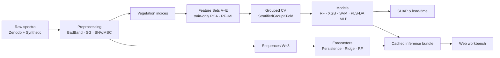

<div align="center">

# 🌿 TerraSpectra

### Hyperspectral Crop Stress Detection & Temporal Forecasting

**Honest, leak-free spectral machine learning, from raw leaf reflectance to explainable stress detection and multi-horizon canopy forecasts.**


-orange)


[**Quick Start**](#-quick-start) ·
[**Results**](#-key-results) ·
[**Methodology**](#-methodology) ·
[**Web App**](#-web-application) ·
[**Docs**](#-documentation) ·
[**Limitations**](#-limitations)

</div>

---

## ✨ Highlights

| | |
|---|---|
| 🔒 **Zero-leakage by design** | Every split is grouped by `Plant_ID`; every transform is fit on training folds only |
| 📉 **Leakage quantified** | A naive split inflates XGBoost Macro-F1 by **+0.0881** (0.4877 honest vs 0.5758 leaky) |
| 📈 **Strong forecasting** | Lag-Feature Random Forest cuts `k=+3` NDVI MAE by **52.5%** vs Persistence (R² **0.9425**) |
| 🔍 **Explainable** | Validation-fold SHAP ranks wavelengths and indices; early-detection lead time on unseen plants |
| 🧪 **Reproducible** | Frozen folds, per-stage JSON metrics, experiment log, immutable raw data |
| 🖥 **Usable** | Live spectrum classifier, batch CSV scorer and NDVI forecaster in a web workbench |

---

## 🧭 Table of Contents

1. [Overview](#-overview)
2. [Key Results](#-key-results)
3. [Quick Start](#-quick-start)
4. [Data Sources](#-data-sources)
5. [Methodology](#-methodology)
6. [Vegetation Indices](#-vegetation-indices)
7. [Evaluation Protocol](#-evaluation-protocol)
8. [Design Decisions](#-design-decisions)
9. [Installation](#-installation)
10. [Running the Full Pipeline](#-running-the-full-pipeline)
11. [Web Application](#-web-application)
12. [Repository Structure](#-repository-structure)
13. [Documentation](#-documentation)
14. [Limitations](#-limitations)
15. [Responsible Use](#-responsible-use)
16. [Risks & Mitigations](#-risks--mitigations)
17. [Roadmap](#-roadmap)
18. [Reproducibility](#-reproducibility)
19. [Troubleshooting](#-troubleshooting)
20. [FAQ](#-faq)
21. [Glossary](#-glossary)
22. [Contributing](#-contributing)
23. [Citation](#-citation)
24. [License](#-license)

---

## 🎯 Overview

Spectral datasets usually contain **many repeated scans of the same plant**. When those replicates land in both training and validation sets, models memorise plants instead of learning stress signatures, and reported accuracy looks better than it really is. TerraSpectra is built around one rule:

> **No information from a validation plant may ever reach training.**

On that foundation it solves three connected tasks:

| # | Task | What it does | Core modules |
|---|------|--------------|--------------|
| 1 | **Detection & Diagnosis** | Preprocess spectra, extract vegetation indices, benchmark Random Forest, XGBoost, SVM (RBF), PLS-DA and Neural MLP in grouped CV | `preprocessing.py`, `features.py`, `evaluation.py` |
| 2 | **Interpretability & Early Detection** | Rank wavelengths and indices with SHAP, measure lead time on holdout plants, serve live and batch scoring | `inference.py` |
| 3 | **Temporal Forecasting** | Sliding windows (`W = 3`) forecasting NDVI<sub>t+k</sub>, `k ∈ {1, 2, 3}`, vs Persistence, Ridge and Random Forest | `sequences.py` |

**Who is it for?** Researchers and students in plant phenotyping, remote sensing and applied ML who need a transparent, leakage-safe baseline for spectral stress analysis.

### Project at a glance

| | |
|---|---|
| **Primary data** | 79 plants · 2 genotypes · 31 dates · 10 bands (365–970 nm) · 2,272 clean scans |
| **Companion data** | 120 synthetic scans × 61 bands (400–1000 nm), 4 disease stages |
| **Classifiers** | Random Forest · XGBoost · SVM (RBF) · PLS-DA · Neural MLP |
| **Forecasters** | Persistence · Lag-Feature Ridge · Lag-Feature Random Forest |
| **Indices** | NDVI · NDRE · PRI · MCARI · Red-Edge Position |
| **Interface** | Express + Node web workbench over cached Python models |

---

## 📊 Key Results

### 🔒 Leakage changes the story
**XGBoost, Feature Set E (Macro-F1):**

| Split strategy | Macro-F1 |
| --- | :---: |
| `StratifiedGroupKFold(plant_id)`, honest | **0.4877** |
| Naive random split, leaky | 0.5758 |
| **Inflation from leakage** | **+0.0881** |

> **Takeaway:** ignoring plant identity inflates performance by roughly 9 F1 points. Every headline number in this project uses the grouped figure.

### 📈 Forecasting beats Persistence at every horizon
Setup: `W = 3`, 1,828–1,986 sequences depending on horizon. At `k = +3`:

| Model | MAE ↓ | R² ↑ |
| --- | :---: | :---: |
| Persistence baseline (ŷ<sub>t+k</sub> = y<sub>t</sub>) | 0.0688 | 0.7758 |
| **Lag-Feature Random Forest** | **0.0327** | **0.9425** |
| **MAE reduction** | **52.5%** | |

> **How to read this:** classifying drought stress from 10 bands is genuinely hard once leakage is removed (Macro-F1 ≈ 0.49), while short-horizon NDVI forecasting is far more tractable.

### 🖼 Figures
Publication charts (EDA, preprocessing, features, baselines, error analysis and forecasting) are generated into `reports/figures/` as Figures 01–13. See [Outputs](#outputs).

---

## 🚀 Quick Start

```bash
# 1. Environment
python3 -m venv .venv && source .venv/bin/activate
pip install --upgrade pip && pip install -r requirements.txt

# 2. Place the Zenodo CSVs in data/raw/, then verify and run a core stage
python3 src/pipeline/verify_env.py
python3 src/pipeline/run_day5_baselines.py      # grouped-CV baselines + leakage audit

# 3. Build the model cache and launch the app
python3 src/inference.py --action warm-cache
npm install && npm run dev                      # http://localhost:3000
```

> Stages feed each other. For a clean first run, use the [full ordered pipeline](#-running-the-full-pipeline).

---

## 🗂 Data Sources

| Dataset | Origin | Licence | Scope & Limitations |
| --- | --- | --- | --- |
| **Primary Multi-Temporal Plant Spectra**<br>`data/raw/Multispectral_Reflectance.csv` + `experimental_design.csv` | Zenodo [`10.5281/zenodo.22755812`](https://doi.org/10.5281/zenodo.22755812), *Plant Phenotyping and Environmental Stress Dataset* | **CC-BY-4.0** | 2,285 rows (2,272 clean valid scans), 79 plants (`Plant_ID`), 2 genotypes, 31 dates, 10 bands (365–970 nm). Labels are **abiotic water/drought stress** (`Control 40%` vs `Drought 10%`), **not** pathogen inoculation. |
| **Companion Synthetic Benchmark**<br>`data/raw/synthetic_leaf_disease_spectra_v1.csv` | Local generator: `src/pipeline/generate_synthetic_spectra.py` | **Apache-2.0** | 120 scans × 61 bands (400–1000 nm, 10 nm step), 4 stages (`Healthy`, `Early_Chlorosis`, `Moderate_Blight`, `Severe_Necrosis`), 5 dates. Tagged `SYNTHETIC_CONTROLLED_STRESS`. |

Files in `data/raw/` are **immutable**. Please cite the Zenodo record if you reuse the data.

---

## 🔬 Methodology



### Preprocessing (`src/preprocessing.py`)

| Step | Purpose |
| --- | --- |
| `BadBandDropper` | Drops the noisy 365 nm UV band |
| `ReflectanceSanitizer` | Cleans invalid reflectance values |
| Savitzky–Golay | Denoises spectra |
| SNV / MSC | Scatter normalization |
| First derivative | Emphasises spectral shape over absolute level |

### Features (`src/features.py`)
Uncentered vegetation indices plus **Feature Sets A–E**, built with train-only PCA and RF + mutual-information (MI) selection.

### Models

| Task | Models |
| --- | --- |
| Classification | Random Forest · XGBoost · SVM (RBF) · PLS-DA (`PLSDAClassifier`) · Neural MLP |
| Forecasting | Persistence · Lag-Feature Ridge · Lag-Feature Random Forest |
| Planned (Week 3) | 1D-CNN · GRU / LSTM · *(optional)* 3D-CNN |

### Zero-Leakage Guarantees

| Guarantee | How it is enforced |
| --- | --- |
| Plant-level separation | All splits keyed on `Plant_ID` |
| Fit-on-train-only | PCA, RF + MI selection and scalers fit inside each training fold |
| Frozen folds | CV splits saved in `data/processed/*.json`, shared by all models |
| Chronological forecasting | Windows respect time order; `GroupKFold(plant_id)` |
| Explicit audit | Stage 5 quantifies the naive-vs-grouped gap |

---

## 🌱 Vegetation Indices

Standard literature definitions are shown below. Exact band choices for the 10-band dataset (nearest available band per wavelength) are implemented in `src/features.py`.

| Index | Common formula | Sensitive to |
| --- | --- | --- |
| **NDVI** | (NIR − Red) / (NIR + Red) | Canopy greenness / biomass |
| **NDRE** | (NIR − RedEdge) / (NIR + RedEdge) | Chlorophyll content, early stress |
| **PRI** | (R531 − R570) / (R531 + R570) | Xanthophyll cycle, light-use efficiency |
| **MCARI** | [(R700 − R670) − 0.2 (R700 − R550)] × (R700 / R670) | Chlorophyll absorption |
| **REP** | Wavelength of steepest red-edge slope (~680–750 nm) | Chlorophyll status (red-edge shift) |

---

## 🧪 Evaluation Protocol

| Item | Setting |
| --- | --- |
| Classification CV | Frozen 5-fold `StratifiedGroupKFold(plant_id)` |
| Forecasting CV | `GroupKFold(plant_id)` |
| Classification metric | Macro-F1 from out-of-fold (OOF) predictions |
| Forecasting metrics | MAE and R², compared against Persistence |
| Early detection | Lead time measured on unseen holdout plants |
| Interpretability | SHAP on validation folds only |
| Comparison rule | All models evaluated on identical saved folds |

---

## 🧠 Design Decisions

| Decision | Rationale |
| --- | --- |
| Group by `Plant_ID`, not by row | Replicate scans are correlated; row-level splits reward memorisation |
| Report grouped metrics only | Honest numbers over flattering ones; the naive figure is shown solely as a leakage audit |
| Macro-F1 over accuracy | Treats classes equally and is robust to imbalance |
| Persistence as forecasting baseline | A strong, simple reference; any gain over it is real signal |
| Train-only PCA / feature selection | Prevents validation information leaking through the feature pipeline |
| SHAP on validation folds | Explanations reflect behaviour on unseen plants |
| Deep models treated as optional | A solid baseline, a working demo and a clear report outrank an unfinished deep model |
| Synthetic data clearly tagged | Useful for pipeline validation, never mixed into real-data claims |

---

## ⚙️ Installation

**Prerequisites:** Python 3.10+ and Node.js 18+ with npm (recommended minimums; adjust to your tested environment).

```bash
python3 -m venv .venv
source .venv/bin/activate            # Windows: .venv\Scripts\activate
pip install --upgrade pip
pip install -r requirements.txt
```

**Tech stack:** Python · NumPy · pandas · scikit-learn · XGBoost · PyTorch · `spectral` / `rasterio` / `h5py` (cube I/O) · matplotlib / plotly · SHAP · Node.js + Express · Git/GitHub.

---

## 🔁 Running the Full Pipeline

```bash
# Stage 0: Verify core Python stack imports
python3 src/pipeline/verify_env.py

# Stage 1: Inspect dataset shapes, wavelengths & Plant_ID grouping keys
python3 src/data.py

# Stage 2: Exploratory Data Analysis → Figures 01–04
python3 src/pipeline/run_day2_eda.py

# Stage 3: Leak-free preprocessing → Figures 05–06
python3 src/pipeline/run_day3_preprocessing.py

# Stage 4: Vegetation indices, train-only PCA / RF+MI Sets A–E → Figures 07–08
python3 src/pipeline/run_day4_features.py

# Stage 5: Grouped-CV baselines + leakage audit → Figures 09–10
python3 src/pipeline/run_day5_baselines.py

# Stage 6: Error analysis, SHAP alignment, tuning, forecasting → Figures 11–13
python3 src/pipeline/run_day6_error_and_forecast.py

# Stage 7: Neural comparator, Week 3 readiness & inference model cache
python3 src/week3_models.py
python3 src/inference.py --action warm-cache
```

| Stage | Script | Produces |
| :---: | --- | --- |
| 0 | `verify_env.py` | Environment check |
| 1 | `data.py` | Dataset summary |
| 2 | `run_day2_eda.py` | Figures 01–04 |
| 3 | `run_day3_preprocessing.py` | Preprocessed matrices, Figures 05–06 |
| 4 | `run_day4_features.py` | Sets A–E, Figures 07–08 |
| 5 | `run_day5_baselines.py` | Baseline table, leakage audit, Figures 09–10 |
| 6 | `run_day6_error_and_forecast.py` | Error / SHAP / forecast results, Figures 11–13 |
| 7 | `week3_models.py`, `inference.py` | MLP comparator, cached inference bundle |

### Outputs

| Location | Contents |
| --- | --- |
| `reports/day*_metrics.json` | Structured per-stage metrics |
| `reports/day5_baseline_results.csv` | Baseline results table |
| `reports/experiment_log.csv` | Reproducible experiment tracker |
| `reports/figures/` | Publication PNG charts (01–13) |
| `data/processed/` | Preprocessed matrices, Sets A–E (`.npz`), CV splits (`.json`), cached inference bundle |

---

## 🖥 Web Application


```bash
python3 src/inference.py --action warm-cache   # build the model cache first
npm install
npm run dev
# Open http://localhost:3000
```

| Capability | Description |
| --- | --- |
| Live spectrum classification | Score a single spectrum in real time |
| Batch CSV scoring | Score many scans from a CSV |
| NDVI forecasting | Forecast future canopy NDVI from a plant's recent scans |
| Early-detection lead time | See how far ahead stress is flagged |

<!-- TODO: add screenshots, e.g. docs/images/workbench.png -->

---

## 📁 Repository Structure

```text
.
├── data/
│   ├── raw/                  # Immutable Zenodo CC-BY-4.0 CSVs + synthetic fallback CSV
│   └── processed/            # Preprocessed matrices, Sets A–E (.npz), CV splits (.json), inference bundle
├── docs/
│   ├── project_report.md     # Draft technical report (Sections 1–4 complete, 5–6 outlined + citations)
│   ├── weekly_mentor_update.md  # Milestone summary & Week 3 confirmation request
│   ├── week3_plan.md         # Week 3 1D-CNN, GRU/LSTM & light tuning roadmap
│   ├── project_brief.md      # Scope & metrics framing
│   ├── dataset_note.md       # Portal audit & metadata decision log
│   └── ...                   # Per-stage technical notes
├── notebooks/                # Reproducible EDA, preprocessing, feature, baseline & error notebooks
├── reports/
│   ├── day*_metrics.json
│   ├── day5_baseline_results.csv
│   ├── experiment_log.csv
│   └── figures/              # PNG charts (01–13)
├── src/
│   ├── data.py               # Unified loader (Primary Zenodo + Synthetic)
│   ├── preprocessing.py      # BadBandDropper, ReflectanceSanitizer, SavitzkyGolay, SNV/MSC, 1st derivative
│   ├── features.py           # NDVI, NDRE, PRI, REP, MCARI, train-only PCA, RF+MI selection, Sets A–E
│   ├── evaluation.py         # StratifiedGroupKFold harness, PLSDAClassifier, OOF metrics
│   ├── sequences.py          # Sliding windows & Persistence/Ridge/RF forecasters
│   ├── inference.py          # Live classifier, CSV scorer, forecaster & lead-time engine
│   ├── week3_models.py       # Neural MLP comparator & 1D-CNN / GRU specifications
│   └── pipeline/             # CLI-runnable stage scripts
├── server.ts                 # Express API bridge to Python models
├── README.md
└── requirements.txt
```

---

## 📚 Documentation

| Document | Purpose |
| --- | --- |
| [`docs/project_report.md`](docs/project_report.md) | Full technical report draft |
| [`docs/project_brief.md`](docs/project_brief.md) | Scope, goals and metric framing |
| [`docs/dataset_note.md`](docs/dataset_note.md) | Dataset audit and metadata decisions |
| [`docs/week3_plan.md`](docs/week3_plan.md) | Deep-learning roadmap (1D-CNN, GRU/LSTM) |
| [`docs/weekly_mentor_update.md`](docs/weekly_mentor_update.md) | Progress summary for mentor review |

---

## ⚠️ Limitations

- **Abiotic, not biotic stress:** primary labels are water/drought stress. Do **not** read results as pathogen or disease detection on real crops.
- **Synthetic data is not field data:** it validates the pipeline and dense-band behavior only.
- **Coarse spectral resolution:** 10 bands (365–970 nm) limit fine red-edge and derivative features.
- **Modest honest accuracy:** grouped Macro-F1 ≈ 0.49 (XGBoost, Set E) reflects a hard task once leakage is removed.
- **Small cohort:** 79 plants and 2 genotypes limit claims about other species and environments.
- **Controlled conditions:** results come from a controlled phenotyping setting and may not transfer to field imagery without re-validation.

---

## 🛡 Responsible Use

- Use this project for **research, education and decision support**, not as the sole basis for agronomic or commercial decisions.
- Re-validate on your own species, sensors and conditions before relying on any prediction.
- Report grouped, out-of-fold metrics. Do not present naive-split numbers as model performance.
- Keep synthetic and real data results clearly separated.

---

## 🛡 Risks & Mitigations

| Risk | Mitigation |
| --- | --- |
| No suitable dataset | Decide by end of Week 1; use the documented fallback instead of waiting |
| Curse of dimensionality | Band selection or PCA (train-only), strong regularization, cross-validation |
| Data leakage | Group-based splits on `Plant_ID` plus an explicit leakage audit |
| Time overrun | Treat the 3D-CNN as optional; a solid baseline, working demo and clear report beat an unfinished deep model |
| Plagiarism / attribution | Original code and text; cite every dataset and paper used |

---

## 🗺 Roadmap

| Status | Milestone |
| :---: | --- |
| ✅ | Leak-free preprocessing and feature pipeline |
| ✅ | Grouped-CV baselines (RF, XGBoost, SVM, PLS-DA) and leakage audit |
| ✅ | SHAP interpretability and early-detection lead time |
| ✅ | Multi-horizon forecasting (Persistence / Ridge / RF) |
| ✅ | Neural MLP comparator and live inference app |
| 🔄 | 1D-CNN and GRU / LSTM models (`docs/week3_plan.md`) |
| ⬜ | Light hyperparameter tuning across models |
| ⬜ | Finish report Sections 5–6 |
| ⬜ | *(Optional)* 3D-CNN on hyperspectral cubes |

---

## 🔁 Reproducibility

- [x] Frozen CV folds saved to `data/processed/`
- [x] Preprocessing, PCA and selection fit on training folds only
- [x] Per-stage metrics in `reports/day*_metrics.json`
- [x] Experiment tracker in `reports/experiment_log.csv`
- [x] Immutable raw data
- [ ] Pin random seeds and dependency versions in `requirements.txt` (confirm)

---

## 🩺 Troubleshooting

| Problem | Likely fix |
| --- | --- |
| `ModuleNotFoundError` | Activate `.venv`, re-run `pip install -r requirements.txt`, check with `verify_env.py` |
| Web app shows no predictions | Run `python3 src/inference.py --action warm-cache` first |
| Missing data file errors | Confirm both Zenodo CSVs are in `data/raw/` with exact filenames |
| Port 3000 already in use | Stop the other process or change the port in `server.ts` |
| A later stage fails | Run earlier stages first; each stage's outputs feed the next |

---

## ❓ FAQ

**Why is Macro-F1 only ~0.49?**
The evaluation is honest: plants never cross folds and the data has only 10 bands. The naive split's 0.5758 is inflated by leakage.

**Is this disease detection?**
No. The real data captures drought stress. The synthetic benchmark simulates disease stages but is not real.

**Why compare against Persistence?**
It is a strong, simple time-series baseline. Cutting MAE by 52.5% at `k = +3` shows the lag features add real signal.

**Why group by `Plant_ID`?**
Repeated scans of one plant are highly correlated. Grouping stops the model being rewarded for recognising a plant it has already seen.

**Can I use my own data?**
Yes, if it provides a plant identifier, wavelengths and a label. Adapt `src/data.py` to load it and keep the grouped-CV rules.

---

## 📖 Glossary

| Term | Meaning |
| --- | --- |
| **Leakage** | Information from validation data influencing training, inflating metrics |
| **Grouped CV** | Cross-validation where all samples of one group (plant) stay in the same fold |
| **OOF** | Out-of-fold: predictions made on data a model did not train on |
| **Macro-F1** | F1 averaged equally across classes |
| **SNV / MSC** | Standard Normal Variate / Multiplicative Scatter Correction |
| **SG filter** | Savitzky–Golay smoothing filter |
| **SHAP** | Shapley-value-based feature attribution |
| **PLS-DA** | Partial Least Squares Discriminant Analysis |
| **REP** | Red-Edge Position |
| **Persistence** | Baseline that predicts the future equals the latest observation |
| **Lead time** | How much earlier stress is detected than a reference point |

---

## 🤝 Contributing

Contributions are welcome.

1. Fork the repo and create a feature branch.
2. Keep all splits grouped by `Plant_ID`; fit every transform on training data only.
3. Log new experiments in `reports/experiment_log.csv`.
4. Include before/after grouped-CV metrics in your pull request.
5. Cite any new dataset or paper and write original code and text.

---

## 📚 Citation

If you use TerraSpectra or its data, please cite the source dataset:

> *Plant Phenotyping and Environmental Stress Dataset.* Zenodo. https://doi.org/10.5281/zenodo.22755812 (CC-BY-4.0)

```bibtex
@dataset{terraspectra_source,
  title     = {Plant Phenotyping and Environmental Stress Dataset},
  publisher = {Zenodo},
  doi       = {10.5281/zenodo.22755812},
  license   = {CC-BY-4.0}
}
```

<!-- TODO: add original dataset authors and year from the Zenodo record -->

---

## 📄 License

| Component | Licence |
| --- | --- |
| Source code | See `LICENSE` in the repository root |
| Primary dataset | CC-BY-4.0 (attribution required) |
| Synthetic benchmark | Apache-2.0 |

---

<div align="center">

**TerraSpectra**: spectral machine learning you can trust, because it never peeks. 🌿

</div>
