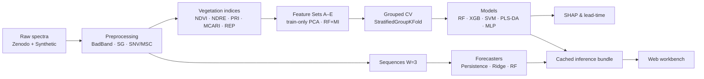

<div align="center">

# 🌿 TerraSpectra

### Hyperspectral Crop Stress Detection & Temporal Forecasting

*Leak-free spectral machine learning, from raw leaf reflectance to explainable stress detection and multi-horizon canopy forecasts.*


-orange)


[Quick Start](#-quick-start) · [Key Results](#-key-results) · [Methodology](#-methodology) · [Pipeline](#-running-the-full-pipeline) · [Web App](#-web-application) · [Limitations](#-limitations)

</div>

---

## 📌 At a Glance

| | |
|---|---|
| **Goal** | Detect crop leaf stress from reflectance spectra and forecast future canopy NDVI |
| **Core principle** | **Zero leakage**: every split is grouped by `Plant_ID`; every transform is fit on training folds only |
| **Primary data** | 79 plants · 2 genotypes · 31 dates · 10 bands (365–970 nm) · 2,272 clean scans |
| **Classifiers** | Random Forest, XGBoost, SVM (RBF), PLS-DA, Neural MLP |
| **Forecasters** | Persistence baseline, Lag-Feature Ridge, Lag-Feature Random Forest |
| **Interpretability** | Validation-fold SHAP (`TreeExplainer`) + early-detection lead time |
| **Interface** | Express + Node web workbench backed by cached Python models |

---

## 🧭 Overview

TerraSpectra solves three connected phenotyping tasks:

| # | Task | Core modules |
|---|------|--------------|
| 1 | **Detection & Diagnosis**: classify leaf stress from spectra | `src/preprocessing.py`, `src/features.py`, `src/evaluation.py` |
| 2 | **Interpretability & Early Detection**: find which wavelengths/indices matter and how early stress is caught | `src/inference.py` |
| 3 | **Temporal Forecasting**: predict future canopy NDVI per plant | `src/sequences.py` |

**1. Detection & Diagnosis**
- Preprocessing: `BadBandDropper` (drops the noisy 365 nm UV band), `ReflectanceSanitizer`, Savitzky–Golay denoising, SNV / MSC scatter normalization, first derivative.
- Vegetation indices (uncentered): **NDVI, NDRE, PRI, MCARI, Red-Edge Position (REP)**.
- Feature Sets **A–E**, built with train-only PCA and RF + mutual-information (MI) selection.
- Benchmarked in a frozen 5-fold `StratifiedGroupKFold(plant_id)`.

**2. Interpretability & Early Detection**
- Ranks wavelengths and indices with validation-fold SHAP values.
- Measures early-detection **lead time** on unseen holdout plants.
- Powers real-time spectrum classification and batch CSV scoring.

**3. Temporal Forecasting**
- Sliding windows of `W = 3` prior dates per plant.
- Forecasts NDVI<sub>t+k</sub> for `k ∈ {1, 2, 3}` against the Persistence baseline (ŷ<sub>t+k</sub> = y<sub>t</sub>), validated with `GroupKFold(plant_id)`.

---

## 🚀 Quick Start

```bash
# 1. Environment
python3 -m venv .venv && source .venv/bin/activate
pip install --upgrade pip && pip install -r requirements.txt

# 2. Place data in data/raw/ (see "Data Sources"), then run the pipeline
python3 src/pipeline/verify_env.py
python3 src/pipeline/run_day5_baselines.py      # grouped-CV baselines + leakage audit

# 3. Launch the web app
python3 src/inference.py --action warm-cache
npm install && npm run dev                      # http://localhost:3000
```

> Stages build on each other. For a clean first run, use the [full ordered pipeline](#-running-the-full-pipeline) below.

---

## 📊 Key Results

### 🔒 Why Plant-Grouped Validation Matters
Naive row-level splits leak replicate scans of the same plant across folds. For **XGBoost on Feature Set E (Macro-F1)**:

| Split strategy | Macro-F1 |
| --- | :---: |
| `StratifiedGroupKFold(plant_id)`, honest | **0.4877** |
| Naive random split, leaky | 0.5758 |
| **Inflation from leakage** | **+0.0881** |

> **Takeaway:** ignoring plant identity makes the model look ~9 F1 points better than it really is. Reported numbers in this project use the grouped, honest figure.

### 📈 Temporal Forecasting (`W = 3`, 1,828–1,986 sequences)
Lag-Feature Random Forest beats Persistence at **every horizon**. At `k = +3`:

| Model | MAE ↓ | R² ↑ |
| --- | :---: | :---: |
| Persistence baseline | 0.0688 | 0.7758 |
| **Lag-Feature Random Forest** | **0.0327** | **0.9425** |
| **MAE reduction** | **52.5%** | |

> Grouped Macro-F1 around 0.49 shows that stress classification from 10 bands is genuinely hard once leakage is removed, while NDVI forecasting is far more tractable.

---

## 🗂 Data Sources

| Dataset | Origin | Licence | Scope & Limitations |
| --- | --- | --- | --- |
| **Primary Multi-Temporal Plant Spectra**<br>`data/raw/Multispectral_Reflectance.csv` + `experimental_design.csv` | Zenodo [`10.5281/zenodo.22755812`](https://doi.org/10.5281/zenodo.22755812), *Plant Phenotyping and Environmental Stress Dataset* | **CC-BY-4.0** | 2,285 rows (2,272 clean valid scans), 79 plants (`Plant_ID`), 2 genotypes, 31 dates, 10 bands (365–970 nm). Labels are **abiotic water/drought stress** (`Control 40%` vs `Drought 10%`), **not** pathogen inoculation. |
| **Companion Synthetic Benchmark**<br>`data/raw/synthetic_leaf_disease_spectra_v1.csv` | Local generator: `src/pipeline/generate_synthetic_spectra.py` | **Apache-2.0** | 120 scans × 61 bands (400–1000 nm, 10 nm step), 4 stages (`Healthy`, `Early_Chlorosis`, `Moderate_Blight`, `Severe_Necrosis`), 5 dates. Tagged `SYNTHETIC_CONTROLLED_STRESS`. |

Files in `data/raw/` are treated as **immutable**. Please cite the Zenodo record if you reuse the data.

---

## 🔬 Methodology



### Zero-Leakage Guarantees

| Guarantee | How it is enforced |
| --- | --- |
| Plant-level separation | All splits keyed on `Plant_ID`; replicates of one plant never straddle train/validation |
| Fit-on-train-only | PCA, RF + MI selection and scalers are fit inside each training fold |
| Frozen folds | CV splits saved in `data/processed/*.json` so all models share identical partitions |
| Chronological forecasting | Windows respect time order and use `GroupKFold(plant_id)` |
| Explicit audit | Stage 5 quantifies the naive-vs-grouped gap (+0.0881 Macro-F1) |

### Models Benchmarked

| Task | Models |
| --- | --- |
| Classification | Random Forest · XGBoost · SVM (RBF) · PLS-DA (`PLSDAClassifier`) · Neural MLP |
| Forecasting | Persistence · Lag-Feature Ridge · Lag-Feature Random Forest |
| Planned (Week 3) | 1D-CNN · GRU / LSTM · *(optional)* 3D-CNN |

---

## 🧰 Tech Stack

| Layer | Tools |
| --- | --- |
| Core ML | Python, NumPy, pandas, scikit-learn, XGBoost, PyTorch |
| Spectral / cube I/O | `spectral`, `rasterio`, `h5py` |
| Interpretability | SHAP |
| Visualization | matplotlib, plotly |
| Web workbench | Node.js, Express (`server.ts`) bridging to Python artifacts |
| Workflow | Git / GitHub |

---

## ⚙️ Installation

**Prerequisites:** Python 3.10+ and Node.js 18+ with npm (version minimums are recommended defaults; adjust to your tested environment).

```bash
python3 -m venv .venv
source .venv/bin/activate            # Windows: .venv\Scripts\activate
pip install --upgrade pip
pip install -r requirements.txt
```

---

## 🔁 Running the Full Pipeline

Run the stages in order:

```bash
# Stage 0: Verify core Python stack imports
python3 src/pipeline/verify_env.py

# Stage 1: Inspect dataset shapes, wavelengths & Plant_ID grouping keys
python3 src/data.py

# Stage 2: Exploratory Data Analysis → Figures 01–04
python3 src/pipeline/run_day2_eda.py

# Stage 3: Leak-free preprocessing → Figures 05–06
python3 src/pipeline/run_day3_preprocessing.py

# Stage 4: Vegetation indices, train-only PCA / RF+MI Sets A–E → Figures 07–08
python3 src/pipeline/run_day4_features.py

# Stage 5: Grouped-CV baselines (RF, XGBoost, SVM, PLS-DA) + leakage audit → Figures 09–10
python3 src/pipeline/run_day5_baselines.py

# Stage 6: Error analysis, SHAP alignment, tuning, forecasting → Figures 11–13
python3 src/pipeline/run_day6_error_and_forecast.py

# Stage 7: Neural comparator, Week 3 readiness & inference model cache
python3 src/week3_models.py
python3 src/inference.py --action warm-cache
```

| Stage | Script | Produces |
| :---: | --- | --- |
| 0 | `verify_env.py` | Environment check |
| 1 | `data.py` | Dataset summary |
| 2 | `run_day2_eda.py` | Figures 01–04 |
| 3 | `run_day3_preprocessing.py` | Preprocessed matrices, Figures 05–06 |
| 4 | `run_day4_features.py` | Sets A–E, Figures 07–08 |
| 5 | `run_day5_baselines.py` | Baseline table, leakage audit, Figures 09–10 |
| 6 | `run_day6_error_and_forecast.py` | Error/SHAP/forecast results, Figures 11–13 |
| 7 | `week3_models.py`, `inference.py` | MLP comparator, cached inference bundle |

### Outputs

| Location | Contents |
| --- | --- |
| `reports/day*_metrics.json` | Structured per-stage metrics |
| `reports/day5_baseline_results.csv` | Baseline results table |
| `reports/experiment_log.csv` | Reproducible experiment tracker |
| `reports/figures/` | Publication PNG charts (01–13) |
| `data/processed/` | Preprocessed matrices, Sets A–E (`.npz`), CV splits (`.json`), cached inference bundle |

---

## 🖥 Web Application

```bash
python3 src/inference.py --action warm-cache   # build model cache first
npm install
npm run dev
# Open http://localhost:3000
```

`server.ts` is an Express bridge to the live Python models and artifacts. The workbench supports:

- **Live spectrum classification** for a single spectrum
- **Batch CSV scoring**
- **Canopy NDVI forecasting**
- **Early-detection lead-time** analysis

---

## 📁 Repository Structure

```text
.
├── data/
│   ├── raw/                  # Immutable Zenodo CC-BY-4.0 CSVs + synthetic fallback CSV
│   └── processed/            # Preprocessed matrices, Sets A–E (.npz), CV splits (.json), inference bundle
├── docs/
│   ├── project_report.md     # Draft technical report (Sections 1–4 complete, 5–6 outlined + citations)
│   ├── weekly_mentor_update.md  # Milestone summary & Week 3 confirmation request
│   ├── week3_plan.md         # Week 3 1D-CNN, GRU/LSTM & light tuning roadmap
│   ├── project_brief.md      # Scope & metrics framing
│   ├── dataset_note.md       # Portal audit & metadata decision log
│   └── ...                   # Per-stage technical notes
├── notebooks/                # Reproducible EDA, preprocessing, feature, baseline & error notebooks
├── reports/
│   ├── day*_metrics.json
│   ├── day5_baseline_results.csv
│   ├── experiment_log.csv
│   └── figures/              # PNG charts (01–13)
├── src/
│   ├── data.py               # Unified loader (Primary Zenodo + Synthetic)
│   ├── preprocessing.py      # BadBandDropper, ReflectanceSanitizer, SavitzkyGolay, SNV/MSC, 1st derivative
│   ├── features.py           # NDVI, NDRE, PRI, REP, MCARI, train-only PCA, RF+MI selection, Sets A–E
│   ├── evaluation.py         # StratifiedGroupKFold harness, PLSDAClassifier, OOF metrics
│   ├── sequences.py          # Sliding windows & Persistence/Ridge/RF forecasters
│   ├── inference.py          # Live classifier, CSV scorer, forecaster & lead-time engine
│   ├── week3_models.py       # Neural MLP comparator & 1D-CNN / GRU specifications
│   └── pipeline/             # CLI-runnable stage scripts
├── server.ts                 # Express API bridge to Python models
├── README.md
└── requirements.txt
```

---

## ⚠️ Limitations

- **Abiotic, not biotic stress:** primary labels are water/drought stress. Do **not** read results as pathogen or disease detection on real crops.
- **Synthetic data is not field data:** the synthetic benchmark validates the pipeline and dense-band behavior only.
- **Coarse spectral resolution:** 10 bands (365–970 nm) limit fine red-edge and derivative features.
- **Modest honest accuracy:** grouped Macro-F1 ≈ 0.49 (XGBoost, Set E) reflects a hard task once leakage is removed.
- **Small cohort:** 79 plants and 2 genotypes limit claims about other species and environments.

---

## 🛡 Risks & Mitigations

| Risk | Mitigation |
| --- | --- |
| No suitable dataset | Decide by end of Week 1; use the documented fallback instead of waiting |
| Curse of dimensionality (few samples, many bands) | Band selection or PCA (train-only), strong regularization, cross-validation |
| Data leakage | Group-based splits on `Plant_ID` plus an explicit leakage audit |
| Time overrun | Treat the 3D-CNN as optional; a solid baseline, working demo and clear report beat an unfinished deep model |
| Plagiarism / attribution | Original code and text; cite every dataset and paper used |

---

## 🗺 Roadmap

- [x] Leak-free preprocessing and feature pipeline
- [x] Grouped-CV baselines (RF, XGBoost, SVM, PLS-DA) and leakage audit
- [x] SHAP interpretability and early-detection lead time
- [x] Multi-horizon forecasting (Persistence / Ridge / RF)
- [x] Neural MLP comparator and live inference app
- [ ] 1D-CNN and GRU / LSTM models (`docs/week3_plan.md`)
- [ ] Light hyperparameter tuning across models
- [ ] Finish report Sections 5–6
- [ ] *(Optional)* 3D-CNN on hyperspectral cubes

---

## 🧪 Reproducibility Checklist

- [x] Frozen CV folds saved to `data/processed/`
- [x] All preprocessing, PCA and selection fit on training folds only
- [x] Per-stage metrics in `reports/day*_metrics.json`
- [x] Experiment tracker in `reports/experiment_log.csv`
- [x] Immutable raw data
- [ ] Pin random seeds and dependency versions in `requirements.txt` (confirm)

---

## 🩺 Troubleshooting

| Problem | Likely fix |
| --- | --- |
| `ModuleNotFoundError` | Activate `.venv` and re-run `pip install -r requirements.txt`; verify with `verify_env.py` |
| Web app shows no predictions | Run `python3 src/inference.py --action warm-cache` first |
| Missing data file errors | Confirm both Zenodo CSVs are in `data/raw/` with exact filenames |
| Port 3000 in use | Stop the other process or change the port in `server.ts` |
| Later stage fails | Run earlier stages first; outputs from each stage feed the next |

---

## ❓ FAQ

**Why is Macro-F1 only ~0.49?**
Because the evaluation is honest. Plants never cross folds, and the data has only 10 bands. The naive split's 0.5758 is inflated by leakage.

**Is this disease detection?**
No. The real data captures drought stress. The synthetic benchmark simulates disease stages but is not real.

**Why compare against Persistence?**
It is the hardest simple baseline for time series. Beating it (52.5% lower MAE at `k = +3`) shows the lag features add real signal.

---

## 🤝 Contributing

1. Fork and create a feature branch.
2. Keep all splits grouped by `Plant_ID` and fit every transform on training data only.
3. Log new experiments in `reports/experiment_log.csv`.
4. Open a pull request describing the change and its effect on grouped-CV metrics.

---

## 📚 Citation & Acknowledgements

Please cite the source dataset:

> *Plant Phenotyping and Environmental Stress Dataset.* Zenodo. https://doi.org/10.5281/zenodo.22755812 (CC-BY-4.0)

```bibtex
@dataset{terraspectra_source,
  title     = {Plant Phenotyping and Environmental Stress Dataset},
  publisher = {Zenodo},
  doi       = {10.5281/zenodo.22755812},
  license   = {CC-BY-4.0}
}
```

*Add the original authors and year from the Zenodo record before publishing.*

---

## 📄 License

- **Code:** add your chosen license (e.g., MIT or Apache-2.0) and a `LICENSE` file.
- **Primary dataset:** CC-BY-4.0 (attribution required).
- **Synthetic benchmark:** Apache-2.0.
